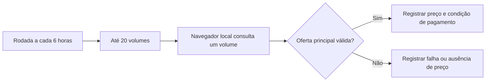

# Alternativas para monitoramento — 09/10/2026

## Contexto e decisão pendente

O usuário considera a hipótese de que consultas diretas ao HTML da Amazon não
estejam mais disponíveis e solicita alternativas. Nenhuma integração foi
implementada ou contratada. A falha observada está em `DiagnosticoHttp500.md`.

## Alternativas verificadas

1. **Keepa API:** a documentação de Product Request lista `com.br` como domínio
   12, aceita ASIN e ISBN-13 e oferece preços, histórico e dados opcionais de
   ofertas/Buy Box. Requer chave; o consumo depende dos parâmetros. Antes de
   contratar, validar custo, cobertura dos volumes reais, atualização e se os
   dados identificam a oferta principal requerida pelo projeto. Suporte
   documentado não equivale a teste dos mangás cadastrados.
   Fonte: https://keepa.com/api-docs/product.html
2. **Amazon Creators API:** inclui Brasil, mas requer conta de associado
   aprovada e vendas qualificadas para cadastro. As políticas brasileiras,
   requisitos de participação, item (y), exigem aprovação da Amazon para
   rastreamento e alertas de preço. Não presumir que obter credenciais autoriza
   automaticamente este monitor.
   Fontes:
   https://affiliate-program.amazon.com/creatorsapi/docs/en-us/onboarding/register-for-creators-api
   https://affiliate-program.amazon.com/creatorsapi/docs/en-us/get-started/using-curl
   https://associados.amazon.com.br/help/operating/policies/
3. **Alertas prontos:** Buscapé permite definir preço-alvo em produtos de seu
   catálogo. Verificar se cada volume/edição e a oferta Amazon desejada estão
   cobertos. Esta opção resolve alertas pessoais, mas não estabelece uma API
   para alimentar o Manga-Monitor.
   Fonte: https://tiresuaduvida.buscape.com.br/hc/pt-br/articles/360035633032-Como-criar-um-Alerta-de-Pre%C3%A7o

## Proposta para o aplicativo, ainda não aprovada

Consultar uma fonte de preços por identificador do volume; registrar valor,
oferta/vendedor, origem e instante de atualização da fonte; comparar com o
preço-alvo e emitir alerta. Preservar a regra de oferta principal de
`CapturaAmazon.md`. Distinguir preço ausente, dado antigo e falha de consulta;
nenhum desses casos deve virar preço zero ou indisponibilidade de estoque
presumida. Frequência depende do orçamento e da necessidade do usuário.

Não há novas telas, entidades implementadas ou testes nesta avaliação.
Antes de implementar, definir custo aceito, quantidade de volumes, intervalo,
contrato da fonte e apresentação das falhas. Foram feitas perguntas interativas
sobre preferência por API paga, solução sem custo ou alertas prontos, além de
quantidade e frequência.

## Verificação futura

Validar com volumes reais a identificação de edição e oferta principal.
Testes futuros devem cobrir preço válido, preço ausente, dado desatualizado,
limite da API, falha de transporte e alerta apenas quando o preço válido
atingir o alvo definido. Nenhuma suíte foi executada nesta pesquisa.

## Preferência recebida

O usuário escolheu manter o aplicativo sem custo recorrente. APIs pagas deixam
de ser a proposta prioritária. Avaliar coleta local assistida: usuário abre a
página e registra o preço no aplicativo, manualmente ou por uma futura extensão
acionada por clique, se a página estiver acessível. O aplicativo poderia manter
histórico e comparar o valor registrado com o alvo, mas não descobriria quedas
entre visitas. Nada disso foi implementado.

Automação de navegador local é apenas uma alternativa condicional a investigar,
não garantia de acesso: se o acesso automatizado continuar sendo rejeitado,
trocar o cliente HTTP por navegador não resolve necessariamente. Não há fonte
gratuita, irrestrita e automática validada nesta pesquisa para os produtos do
usuário. Foram perguntados o funcionamento do navegador e a aceitação de
coleta assistida versus necessidade de execução automática.

## Frequência e volume definidos pelo usuário

- Coleta deve ser automática; coleta assistida não atende ao requisito.
- No máximo 20 volumes por rodada, a cada 6 horas.
- Em operação contínua, são quatro rodadas e até 80 consultas de produtos por
  dia. Isso não equivale ao total de requisições HTTP: uma página de navegador
  pode carregar diversos recursos.
- Mantida a preferência por ausência de custo recorrente de serviço.

A proposta em avaliação é navegador automatizado local. O volume definido
permite planejar consultas sequenciais, mas não garante aceitação pela Amazon.
Antes de implementação, confirmar acesso pelo navegador, necessidade de login
e ambiente de execução (computador ocasionalmente ligado ou máquina 24 horas).
Também foi solicitada a preferência por avaliar essa abordagem. Nenhuma
automação, dependência, agendamento ou mudança de código foi implementada.

## Respostas e avaliação autorizada

O usuário confirmou que o produto abre no navegador e mostra preço sem login.
Prefere executar no Railway, mas aceita iniciar no PC. Autorizou avaliar o
navegador automatizado antes de implementar. O sucesso local não validará o
ambiente Railway, que terá rede e recursos próprios. Nenhum deploy foi autorizado
ou realizado. Custos de hospedagem devem ser considerados separadamente da
ausência de mensalidade de uma API.

A avaliação usa o produto cadastrado no SQLite da raiz: Kaiju nº 8, volume 9,
ASIN `652590708X`. O navegador conectado à ferramenta de controle não estava
disponível. A preparação alternativa usa Playwright isolado em
`/tmp/manga-monitor-browser-eval`, sem dependências adicionadas ao projeto.
Referência de instalação: https://playwright.dev/docs/browsers.

Critério da avaliação: abrir a página sem login, verificar status e identidade
do produto e confirmar preço visível no bloco de oferta principal. Uma página
carregada sem preço principal não será classificada como consulta de preço
bem-sucedida. Não adicionar produto ao carrinho nem resolver desafios de acesso.

## Resultado da avaliação local — 09/10/2026, 07:48 (America/Sao_Paulo)

**Viabilidade local demonstrada em uma consulta.** Chromium `156.0.8078.4`,
controlado por Playwright em modo sem janela e com perfil novo, recebeu HTTP
200. Título confirmado: `Kaiju n.° 8 vol. 9`. Não houve login, reaproveitamento
de perfil pessoal, proxy ou interação com carrinho. O sandbox interno do
Chromium permaneceu habilitado (`chromiumSandbox: true`).

No bloco principal de compra, o texto e a captura de tela confirmaram:

| Campo | Observação nesta consulta |
|---|---|
| Preço à vista | R$ 41,70, condicionado a Pix ou NuPay |
| Total parcelado | R$ 43,90, em até 2x de R$ 21,95 |
| Vendedor | NewStation |
| Envio | Amazon |
| Disponibilidade exibida | Em estoque |
| Outras ofertas | A partir de R$ 30,00; não é o preço da oferta principal |

O site atribuiu uma localidade de entrega ao perfil novo; não foi configurado
CEP do usuário. O frete mostrado nessa sessão não deve ser generalizado para o
usuário. Antes da implementação, definir se acompanhar preço à vista, preço
sem desconto de pagamento ou ambos, e se o CEP/frete fará parte da comparação.

### Reprodução e artefatos temporários

```sh
PLAYWRIGHT_BROWSERS_PATH=/tmp/manga-monitor-browser-eval/browsers node /tmp/manga-monitor-browser-eval/evaluate.cjs
```

O comando seleciona os navegadores baixados em `/tmp` e executa o script
temporário, que abre somente o produto avaliado, registra observações e fecha
o navegador. A execução exigiu aprovação para acesso à rede fora da sandbox
do ambiente do agente. Retornou código de saída zero, status 200, título do
produto e conteúdo do bloco de compra. A imagem foi inspecionada visualmente.

- Script de avaliação: `/tmp/manga-monitor-browser-eval/evaluate.cjs`.
- Observações: `/tmp/manga-monitor-browser-eval/observation.json`.
- Captura de tela: `/tmp/manga-monitor-browser-eval/page.png`.
- Ferramentas e navegadores instalados somente na pasta temporária. Não houve
  instalação de pacotes de sistema nem uso de sudo. Playwright emitiu aviso de
  sistema não oficialmente suportado e utilizou sua distribuição para Ubuntu;
  o navegador executou com sucesso apesar do aviso.

### Limites e continuidade

Uma consulta bem-sucedida não confirma confiabilidade ao longo de dias, em
20 volumes ou em IP de datacenter. Railway não foi acessado nem configurado.
Não foi implementado coletor no Java, parser definitivo, agenda ou alerta.
A suíte do projeto não foi executada nesta avaliação; a falha de compilação
anterior continua documentada em `DiagnosticoHttp500.md`.

Proposta para implementação futura, sujeita a definição de regras: executar
até 20 consultas sequenciais por rodada a cada 6 horas; validar título/edição,
oferta e condição de pagamento; registrar falhas separadas de preço ausente;
preservar preço anterior com sua data; encerrar uma consulta ao encontrar
desafio ou página de erro. Testar preço à vista versus parcelado, outras ofertas
mais baratas, preço ausente, produto incorreto, erro HTTP e falha de rede.



O diagrama representa a proposta, não funcionalidade entregue. A avaliação
autorizada está concluída; implementação e publicação permanecem pendentes.
