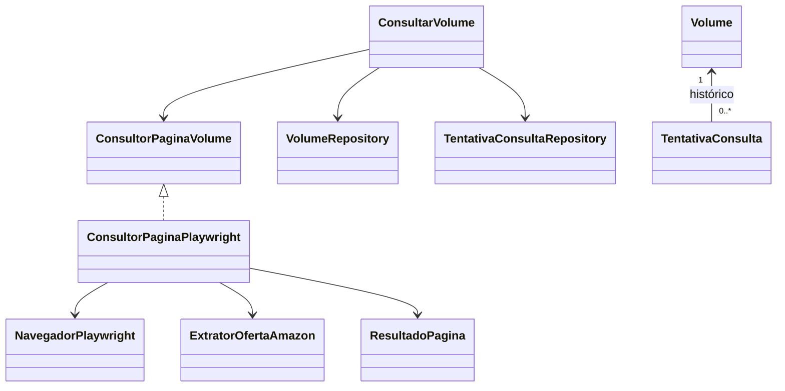
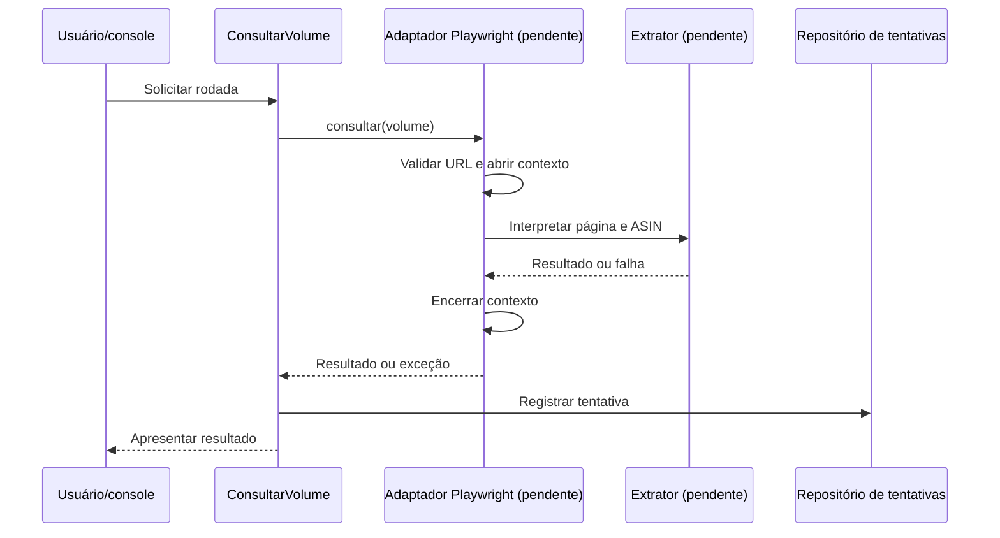

# Reconstrução didática da migração Playwright

## Atualização: POM implementado em 13/10/2026

A pedido do aluno, a etapa de configuração do POM foi implementada:
`playwright.version` define 1.63.0, a dependência
`com.microsoft.playwright:playwright` usa essa propriedade no escopo padrão
de compilação, e `org.codehaus.mojo:exec-maven-plugin:3.5.0` permite executar
a CLI. A versão do Playwright foi conferida no exemplo da
[documentação oficial Java](https://playwright.dev/java/docs/intro).
Os relatos de remoção abaixo descrevem o estado anterior a esta atualização.

Na pasta `Manga-Monitor`, o comando
`./mvnw validate dependency:tree -Dincludes=com.microsoft.playwright:playwright`
valida o POM e mostra a dependência resolvida; passou, confirmando 1.63.0 no
escopo compile. `git diff --check` verifica a formatação do diff e também passou.
`./mvnw -DskipTests compile` tenta compilar sem executar testes, mas encontrou
Java incompleto em `NavegadorPlaywright.java`, linhas 29–32 (`'{' expected` e
fim de arquivo inesperado). O exercício não foi alterado. Testes não foram
executados nesta etapa, pois a compilação está bloqueada.

Para a etapa futura de instalação, o comando
`./mvnw exec:java -Dexec.mainClass=com.microsoft.playwright.CLI -Dexec.args="install chromium"`
executa a CLI e baixa o Chromium compatível com a biblioteca. Esse comando
não foi executado nesta alteração; configurar o POM não instala o navegador.
Veja a [documentação de navegadores](https://playwright.dev/java/docs/browsers).

## Estado em 13/10/2026

Por solicitação do aluno, a implementação exclusiva da migração foi substituída
por comentários passo a passo, inclusive os testes e a fixture HTML. Não há
classes, assinaturas ou solução pronta nos três arquivos de infraestrutura.
Nos arquivos compartilhados foram removidos apenas os trechos de integração,
dependência e configuração do navegador. O cliente HTTP antigo não foi restaurado.

As alterações preexistentes em domínio, persistência, cadastro, consulta e seus
respectivos testes foram preservadas, assim como os bancos de dados. O parâmetro
`--consultar` ainda é reconhecido, mas seu ramo não executa consultas nem grava
tentativas. `--cadastrar` mantém o fluxo existente. Não há nova tela implementada.

## Roteiro de estudo

Todos os caminhos abaixo partem de `Manga-Monitor/`.

| Etapa | Arquivo/local | Entrega esperada |
| --- | --- | --- |
| Preparação | `pom.xml` e `src/main/resources/application.properties` | Declarar dependência, ferramenta de instalação do Chromium e opções do navegador |
| 1 | `src/main/java/com/example/Manga_Monitor/infraestrutura/navegador/NavegadorPlaywright.java` | Criar, isolar e encerrar recursos |
| 2 | Mesma pasta, `ExtratorOfertaAmazon.java` | Interpretar identidade, estoque e preço da oferta principal |
| 3 | Mesma pasta, `ConsultorPaginaPlaywright.java` | Validar URL, navegar e traduzir falhas |
| 4 | `src/test/resources/amazon/oferta-pix.html` | Montar página local com oferta e distrações |
| 5 | `src/test/java/com/example/Manga_Monitor/infraestrutura/navegador/ConsultorPaginaPlaywrightTest.java` | Implementar cenários positivos, ausências e falhas |
| 6 | `src/main/java/com/example/Manga_Monitor/MangaMonitorApplication.java` | Conectar adaptador ao caso de uso e console |

Trabalhe uma etapa por vez e escreva os testes correspondentes à medida que
implementar cada comportamento. Antes de instalar o navegador, confira a versão
escolhida e os requisitos do ambiente. Nenhuma dependência foi instalada nesta
conversão. Os comentários são um roteiro, não uma promessa de compatibilidade
com o HTML atual da Amazon.

## Responsabilidades e relações

`Volume` fornece a URL. `ConsultarVolume` coordena a operação por meio de
`ConsultorPaginaVolume`; o futuro adaptador devolverá `ResultadoPagina` ou
lançará `FalhaConsultaException`. O caso de uso existente registra a tentativa
usando o repositório. `TentativaConsulta` representa o histórico associado ao
volume; o navegador e o extrator não devem salvar entidades.

Diagrama UML da integração pretendida (as classes de navegador estão pendentes):

## Casos de uso e fluxo de console

- **Cadastrar volume:** permanece no fluxo existente de cadastro.
- **Consultar volumes:** está pendente de reconstrução da migração. No fluxo
  final, o console solicitará a rodada ao caso de uso e apresentará o resultado.
- **Oferta disponível:** devolver estoque e preço Pix/NuPay quando identificados.
- **Oferta sem preço elegível:** devolver preço ausente, sem inventar zero.
- **Produto indisponível:** resultado válido com indisponibilidade e preço ausente.
- **Falha técnica:** manter motivo e causa; não registrar indisponibilidade como
  se tivesse sido observada no produto.

## Manual de retomada e validação

Abra os arquivos na ordem do roteiro. Leia primeiro o contrato existente e os
cenários dos testes. Reconstrua cada comportamento sem copiar uma solução pronta.
A validação deve usar respostas locais interceptadas; acesso real à Amazon não
é necessário para a suíte. O arquivo comentado de testes especifica entradas e
resultados esperados, mas ainda não constitui cobertura executável.

Na pasta `Manga-Monitor`, `./mvnw test` executa o Maven Wrapper, compila o código e
executa os testes implementados. Um resultado positivo agora não comprova a
migração, pois seus testes foram substituídos por comentários. Se houver classes
compiladas de execuções anteriores, `./mvnw clean test` remove a pasta de saída do
Maven antes de recompilar e testar; isso evita executar testes antigos removidos
do código-fonte.

## Registro da intervenção

Foram convertidos três arquivos Java de produção, um arquivo Java de testes e
uma fixture HTML para comentários. Foram ajustados somente os trechos relativos
à migração no POM, nas propriedades e na montagem da aplicação. Os documentos
anteriores de diagnóstico continuam sendo registros históricos; este documento
estabelece o estado atual da migração e o próximo trabalho a realizar.

### Resultado da validação

A compilação de produção e testes passou. A execução limpa na sandbox teve
quatro erros de inicialização do Mockito e dois erros de persistência. A repetição
fora da sandbox eliminou os erros do Mockito: 17 testes executados, 15 passaram
e 2 terminaram com erro em `PersistenciaConsultaTest`:

- `persisteHistorico`: referência a Volume de identificador 1 inexistente.
- `respeitaLimiteDaRodada`: NullPointerException na criação de TentativaConsulta.

Esses arquivos não foram alterados nesta intervenção. As causas não foram
investigadas nem corrigidas, pois estão fora do escopo solicitado. Os testes de
Playwright não foram executados: agora são somente roteiros. A verificação
`git diff --check`, que procura problemas de formatação no diff, passou.

## Documentação oficial para estudar

Links consultados em 13/10/2026. Use a seção Java do site.

| Ordem | Leitura | Aplicação no projeto |
| --- | --- | --- |
| 1 | [Introdução e instalação](https://playwright.dev/java/docs/intro) | Dependência Maven e primeiro contato com os objetos |
| 2 | [Navegadores](https://playwright.dev/java/docs/browsers) | Instalação e configuração do Chromium |
| 3 | [Isolamento e contextos](https://playwright.dev/java/docs/browser-contexts) | NavegadorPlaywright: separar sessões de consulta |
| 4 | [Navegação](https://playwright.dev/java/docs/navigations) | ConsultorPaginaPlaywright: abrir URL e entender carregamento |
| 5 | [Localizadores](https://playwright.dev/java/docs/locators) | ExtratorOfertaAmazon: localizar elementos e ler dados |
| 6 | [Rede e interceptação](https://playwright.dev/java/docs/network) | Simular respostas locais, status e falhas nos testes |
| 7 | [Integração com JUnit](https://playwright.dev/java/docs/test-runners#junit) | Preparar e encerrar recursos dos testes |

A [referência da API](https://playwright.dev/java/docs/api/class-playwright)
complementa os guias: consulte as classes pelo menu para conferir parâmetros,
retornos e opções de cada método. A documentação explica os mecanismos da
biblioteca; os comentários do projeto definem responsabilidades e regras de negócio.

Primeira meta de estudo: explicar a diferença entre Playwright, Browser,
BrowserContext e Page antes de implementar NavegadorPlaywright. Nenhum código
foi alterado nesta orientação; testes não se aplicam à inclusão dos links.
