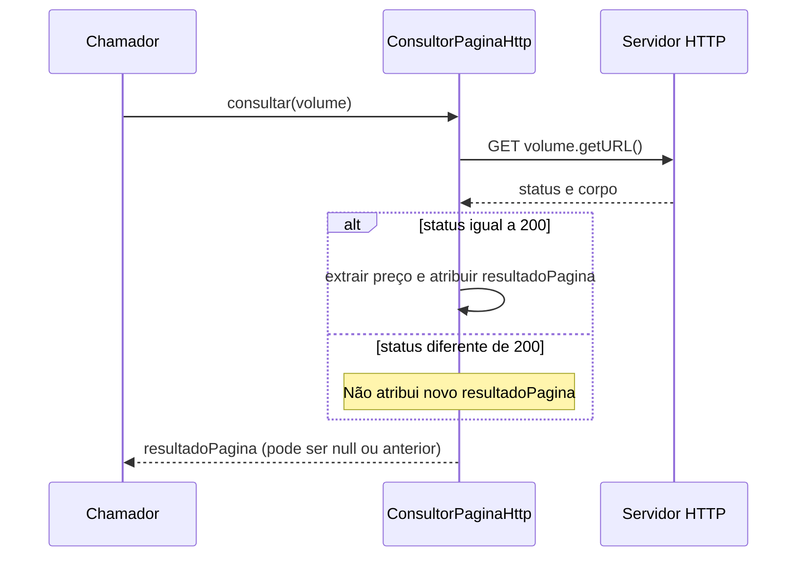
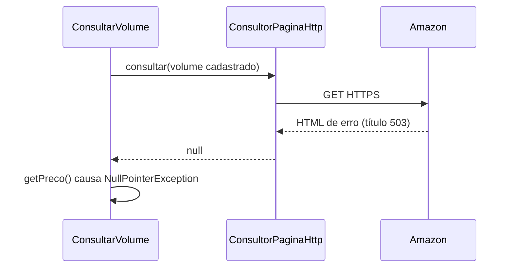

# Investigação de HTTP 500 — 09/10/2026

## Escopo e situação

Investigação solicitada em `ConsultorPaginaHttp.consultar`, sem autorização para alterar código. Após autorização para executar o projeto, foi reproduzida uma resposta externa com HTML intitulado “503 - Erro de serviço indisponível”, seguida de `NullPointerException` local. O status HTTP numérico não é impresso pelo programa. A causa específica da resposta externa e a suspeita de bloqueio de IP permanecem não confirmadas. As seções iniciais abaixo preservam a inspeção anterior; a execução está documentada na seção final.

## Evidências estáticas

- Linha 33: constrói GET para `volume.getURL()`.
- Linha 36: envia a requisição e recebe a resposta.
- Linhas 37–38: compara o status com 200 e lê o corpo.
- Linhas 43–68: só produz novo resultado quando o status é 200.
- Linha 69: retorna um campo da instância; em uma primeira resposta não 200 ele permanece null, e após uma consulta anterior pode conter resultado antigo.
- O status não 200 não é registrado em `motivoDoErro`.
- O tratamento de exceções apenas imprime a stack trace.
- `ConsultorPaginaHttpTest` está desabilitado e seus métodos contêm somente comentários.

Esses problemas de tratamento não comprovam a origem do 500 relatado.

## Fluxo relevante



## Inspeção e continuidade

O IntelliJ informou ausência de sessões de depuração. Um logpoint de leitura do status foi preparado na linha 37 e removido ao encerrar a inspeção, sem hits. Breakpoints do usuário foram preservados. Não houve inicialização do aplicativo nem alteração do código ou dos testes.

Para continuar: obter a URL exata e distinguir status recebido do servidor externo de erro apresentado por outro componente. Capturar status, corpo e cabeçalhos relevantes da resposta, omitindo credenciais, e stack trace se houver. Se `response.statusCode()` for 500, a resposta HTTP recebida tem esse status; a razão específica exige evidência da resposta ou do servidor que a produziu.

Uma eventual correção deve tratar explicitamente respostas não 200, preservar detalhes úteis da falha e impedir reutilização de resultado de outra consulta. Isso permanece recomendação, não implementação.

## Cenários de verificação futura

- Resposta 200 com preço válido: resultado da consulta atual com preço correto.
- Resposta 500 na primeira consulta: falha explícita, sem retorno null silencioso.
- Resposta 200 seguida de 500: segunda consulta não reutiliza o primeiro resultado.
- Exceção de transporte: causa preservada e distinguível de status HTTP recebido.

O contrato exato de retorno versus exceção deverá ser definido antes da implementação.

## Relato de respostas persistentes e suspeita de bloqueio — 09/10/2026

O usuário relata que a Amazon agora retorna 500 continuamente e suspeita de uma
lista de bloqueio. Nesta revisão foram consultados este diagnóstico e
`CapturaAmazon.md`; não houve nova requisição à Amazon, reprodução, execução de
testes ou alteração de código. As evidências estáticas acima pertencem à
inspeção anterior e não foram revalidadas nesta revisão.

O status 500, isoladamente, não confirma bloqueio de IP ou conta. Sua semântica
é de erro inesperado do servidor, sem especificar a causa:
https://developer.mozilla.org/en-US/docs/Web/HTTP/Reference/Status/500.

Foram solicitados ao usuário o local em que o status aparece, um trecho do erro
sem segredos, a frequência e o volume de consultas e o resultado de abrir o
mesmo produto no navegador na mesma rede. A comparação serve para delimitar
o problema; eventual sucesso no navegador, por si só, não confirma nem descarta
restrição às consultas automatizadas. A causa permanece não confirmada.

## Execução autorizada do projeto — 09/10/2026, 07:39 (America/Sao_Paulo)

### Reprodução e resultado

Na subpasta `Manga-Monitor`, que contém o `pom.xml`, foi executado:

```sh
./mvnw -o -Dmaven.test.skip=true -Dspring-boot.run.workingDirectory=.. spring-boot:run > /tmp/manga-monitor-amazon-rede-20261009.log 2>&1
```

O Maven Wrapper usa dependências locais (`-o`), dispensa a compilação e execução
dos testes nesta chamada (`maven.test.skip`), inicia a aplicação com a raiz como
diretório de trabalho e grava saída e erros no log temporário. Foi necessário
autorizar execução fora da sandbox: nela, a abertura de conexão falhou com
`SocketException: Operation not permitted`, antes de qualquer resposta HTTP.

A aplicação seleciona automaticamente a opção 2. O banco da raiz contém um
volume; o banco da subpasta contém zero. A consulta real retornou HTML com:

```text
503 - Erro de serviço indisponível
Para discutir o acesso automatizado aos dados da Amazon, entre em contato com api-services-support@amazon.com.
```

O comentário sobre acesso automatizado é indício compatível com uma restrição
à consulta automatizada, mas não prova bloqueio de IP, conta ou sua duração.
Não houve comparação com navegador. Como o código imprime apenas o corpo, não
foi capturado o status HTTP numérico nem os cabeçalhos; o título do HTML não
deve ser confundido com uma captura de `response.statusCode()`.

Após a resposta, ocorreu:

```text
NullPointerException: Cannot invoke "com.example.Manga_Monitor.dominio.ResultadoPagina.getPreco()" because "resultadoPagina" is null
at com.example.Manga_Monitor.aplicacao.ConsultarVolume.consultarVolume(ConsultarVolume.java:29)
```

O código atual só atribui resultado quando recebe status 200. A resposta sem
resultado provoca retorno null e interrompe a consulta ao ler o preço. Não
houve INSERT de tentativa no log desta execução. O Maven encerrou com
`BUILD SUCCESS` apesar da exceção na thread `restartedMain`: esse marcador
isolado não valida o sucesso da consulta.



### Limitações, testes e efeitos da execução

- A chamada inicial `./mvnw -o spring-boot:run` falhou com sete erros na
  compilação de `VolumeJsonRepositoryTest`, por referências a
  `VolumeJsonRepository` e ao método `salvar` ausentes. Não foram corrigidos;
  a suíte não foi executada. Log: `/tmp/manga-monitor-diagnostico-20261009.log`.
- Uma execução intermediária usou o banco vazio da subpasta. O Hibernate,
  configurado com `ddl-auto=update`, executou
  `alter table tentativa_consulta add column volume_id bigint not null` nesse
  banco. Nenhum produto foi consultado nessa execução.
- Nenhum código-fonte ou teste foi alterado. A alteração preexistente do usuário
  em `ConsultorPaginaHttp.java` foi preservada.
- A execução prova a falha local por resultado null e captura a página externa
  de erro. Não estabelece a causa interna da resposta da Amazon, frequência
  histórica de consultas ou uma lista de bloqueio.
- Próxima correção, se solicitada: definir o contrato de falha e cobrir resposta
  não 200 e exceção de transporte, sem null silencioso e sem preço fictício.
